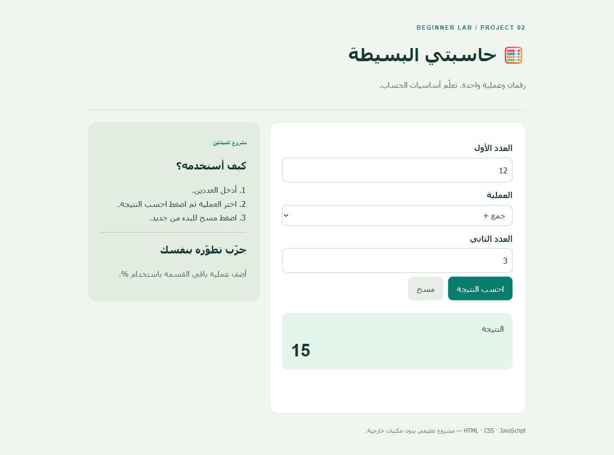

# 🧮 حاسبتي البسيطة

رقمان وعملية واحدة. تعلّم أساسيات الحساب.

مشروع للمبتدئين باستخدام **HTML وCSS وJavaScript**، أُعدّ بمساعدة الذكاء الاصطناعي للتعلّم والتجربة. اقرأه وعدّله بنفسك لتفهمه.

## 🖼️ صورة الواجهة

صورة من التطبيق الفعلي، وقد تتضمن بيانات تجريبية.

## ▶️ طريقة التشغيل

1. اضغط **Code → Download ZIP** ثم فك الضغط.
2. افتح `index.html` في متصفح حديث. لا تحتاج إلى تثبيت مكتبات.
3. افتح الملفات في محرر نصوص للتعديل، احفظها، ثم حدّث الصفحة.

إذا كان Python متوفرًا، يمكنك تشغيل `python -m http.server 8000` من مجلد المشروع ثم فتح `http://localhost:8000`. هذا يعطي عنوانًا ثابتًا للتخزين المحلي؛ سلوك التخزين عند فتح الملفات مباشرة يختلف بين المتصفحات.

## 🕹️ طريقة الاستخدام

1. أدخل العددين.
2. اختر العملية ثم اضغط احسب النتيجة.
3. اضغط مسح للبدء من جديد.

## 📁 الملفات

| الملف | وظيفته |
| --- | --- |
| `index.html` | عناصر الصفحة والنماذج |
| `style.css` | الألوان والمسافات وتصميم الهاتف |
| `script.js` | منطق التطبيق وتعليقات عربية |
| `docs/LEARN.md` | شرح وتدريب خطوة بخطوة |
| `docs/screenshot.png` | لقطة من الواجهة |

## 🧠 ما الذي تتعلّمه؟

- الدوال وswitch
- التحقق من الأعداد
- معالجة القسمة على صفر

## ✏️ تحدٍّ للمبتدئ

أضف عملية باقي القسمة باستخدام %. 

## 🧪 التحقق اليدوي

- أدخل العددين.
- اختر العملية ثم اضغط احسب النتيجة.
- اضغط مسح للبدء من جديد.
- جرّب الحقول الفارغة والقيم غير الصالحة.
- جرّب عرضًا ضيقًا بمقاس الهاتف.

## حدود المشروع

تمرين محلي دون حسابات أو خادم أو مزامنة. لا يرسل المدخلات إلى خدمة خارجية. قائمة المهام ومتتبع المصروفات يحفظان البيانات في متصفحك فقط عند توفر localStorage؛ مسح بيانات الموقع يمسحها. بقية المشاريع تبدأ من جديد عند تحديث الصفحة. استخدم بيانات تجريبية.
